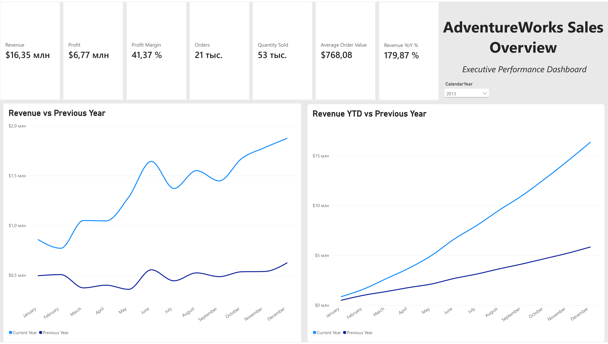
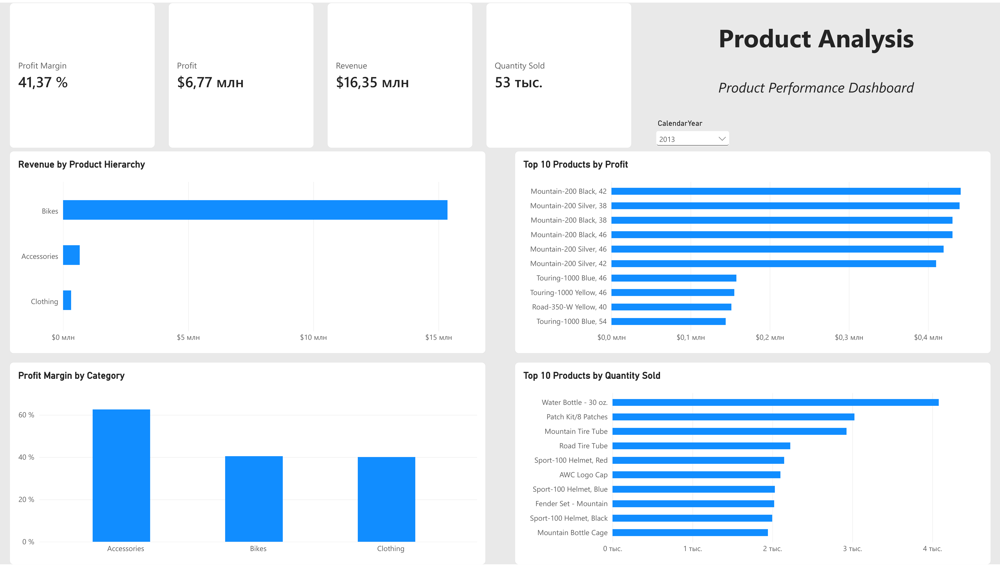
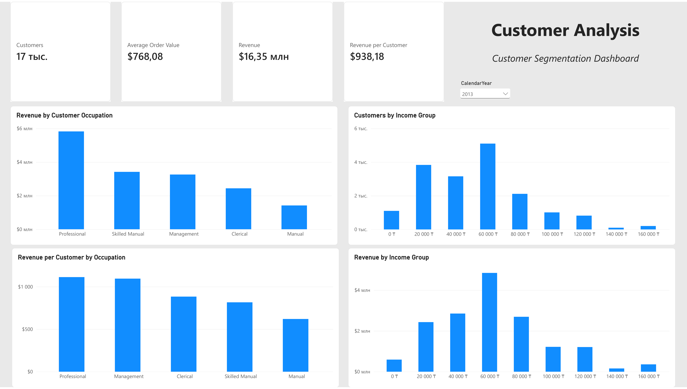
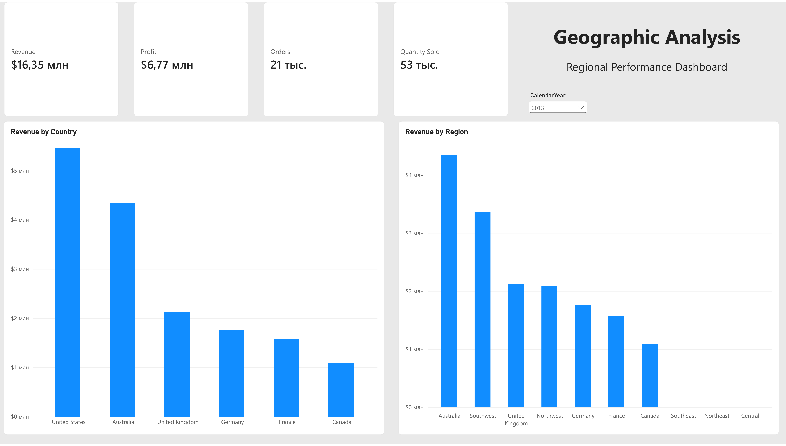
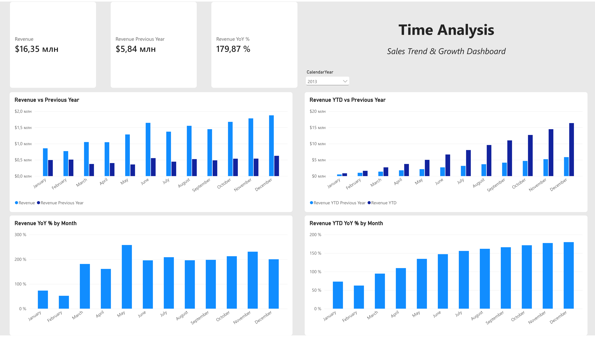
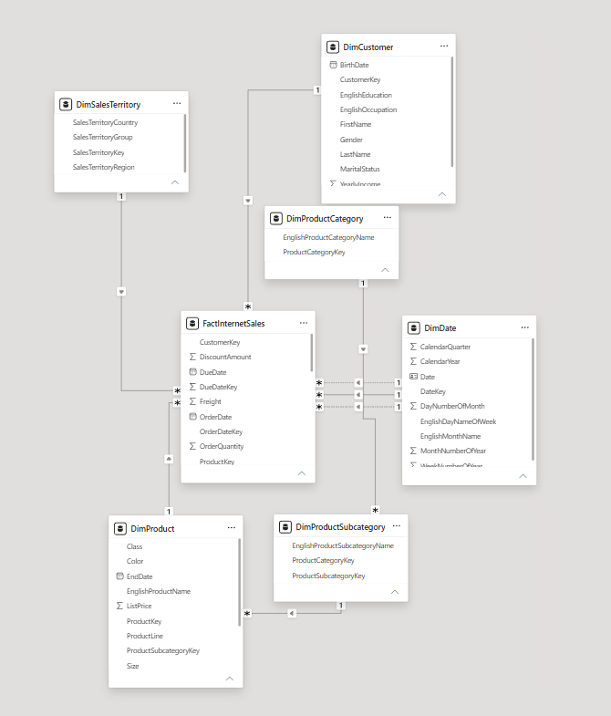

# AdventureWorks Sales Analysis | Power BI

An end-to-end Power BI sales analytics project built on the AdventureWorks dataset. The report combines executive KPIs, product performance, customer segmentation, geographic analysis, and time-intelligence views in a five-page interactive dashboard.

## Live Dashboard

[Open the interactive Power BI report](https://app.powerbi.com/links/BynCJQ-POV?ctid=1cd03a56-3a2e-40dc-aefc-09745cd2cbc2&pbi_source=linkShare)

## Dashboard Pages

1. **Executive Overview** - revenue, profit, margin, orders, quantity sold, average order value, YoY performance, and YTD comparison.
2. **Product Analysis** - category revenue, profit margin by category, top products by profit, and top products by quantity sold.
3. **Customer Analysis** - customer count, revenue per customer, occupation segments, and income-group behavior.
4. **Geographic Analysis** - revenue performance by country and sales territory region.
5. **Time Analysis** - monthly revenue, previous-year comparison, YTD performance, monthly YoY growth, and YTD YoY growth.

## Key KPIs

For the selected 2013 view:

| KPI | Value |
|---|---:|
| Revenue | **$16.35M** |
| Profit | **$6.77M** |
| Profit Margin | **41.37%** |
| Orders | **21K** |
| Quantity Sold | **53K** |
| Average Order Value | **$768.08** |
| Revenue YoY | **179.87%** |

## Key Insights

- **Bikes dominate total revenue**, substantially exceeding Accessories and Clothing.
- **Accessories have the highest profit margin**, at roughly 62%, while Bikes and Clothing are around 40%.
- The **Professional** occupation segment generates the most revenue and also has the highest revenue per customer.
- The **60K income group** contains the largest customer segment and generates the highest revenue among the income bands.
- The **United States** is the strongest country by revenue, followed by Australia.
- Current-year monthly revenue remains above the previous year throughout the selected period.
- Monthly YoY growth is strongest around **May**, while **February** shows the weakest YoY growth in the selected year.

## Data Model

The report uses a fact-and-dimension model centered on **FactInternetSales** with:

- DimDate
- DimCustomer
- DimProduct
- DimProductSubcategory
- DimProductCategory
- DimSalesTerritory

This structure supports slicing sales measures across time, customers, products, and geography.

## Core Measures

The model includes business and time-intelligence measures such as:

- Revenue
- Cost
- Profit
- Profit Margin
- Orders
- Quantity Sold
- Customers
- Average Order Value
- Revenue per Customer
- Revenue Previous Year
- Revenue YoY %
- Revenue YTD
- Revenue YTD Previous Year
- Revenue YTD YoY %

## Skills Demonstrated

- Power BI Desktop
- DAX measures
- Time intelligence: previous year, YTD, and YoY
- Data modeling and relationships
- KPI design
- Product and customer segmentation
- Geographic sales analysis
- Interactive slicers and cross-filtering
- Dashboard layout and visual consistency

## Project Files

- [Download the Power BI project](AdventureWorks_Sales_Analysis.pbix) - editable `.pbix` file
- [View the exported report](AdventureWorks_Sales_Analysis.pdf) - five-page PDF
- [Browse dashboard screenshots](screenshots/) - report pages and data model preview

## Dashboard Preview

### Executive Overview



### Product Analysis



### Customer Analysis



### Geographic Analysis



### Time Analysis



### Data Model



## Repository Structure

```text
adventureworks-powerbi-sales-analysis/
├── AdventureWorks_Sales_Analysis.pbix
├── AdventureWorks_Sales_Analysis.pdf
├── README.md
├── PROJECT_NOTES.md
└── screenshots/
    ├── executive-overview.png
    ├── product-analysis.png
    ├── customer-analysis.png
    ├── geographic-analysis.png
    ├── time-analysis.png
    └── data-model.png
```

## Author

**Yrysdaulet**  
Portfolio project focused on Power BI, business intelligence, data analytics, and DAX.
